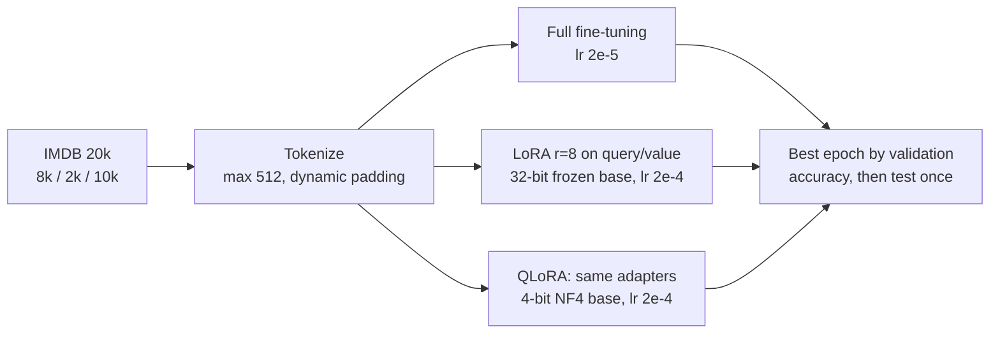

# QLoRA vs. LoRA vs. Full Fine-Tuning of BERT, Measured

**What does QLoRA actually buy on a small model? Trained three ways on the same GPU and data, `bert-base-uncased` reaches 92.3% on IMDB sentiment with full fine-tuning and 91.6% with both LoRA and QLoRA. Training only adapters cuts peak memory from 2.32 GB to about 1.2 GB, but the 4-bit part of QLoRA adds nothing on top: plain LoRA uses as little memory (1.23 vs. 1.29 GB), trains faster (14.2 vs. 17.4 minutes) and predicts twice as fast (15.5 vs. 31.7 ms).** 4-bit quantization earns its keep on models too large to fit on the GPU otherwise; on a 110M-parameter model it is pure overhead. The measurement is the point: the original version of this project claimed a 16.5x memory saving from an unmeasured estimate.

[](https://github.com/dojedaro/qlora-bert-sentiment-classification/actions/workflows/ci.yml)
[](https://colab.research.google.com/github/dojedaro/qlora-bert-sentiment-classification/blob/main/notebooks/run_experiment.ipynb)

## Results

IMDB reviews ([`dipanjanS/imdb_sentiment_finetune_dataset20k`](https://huggingface.co/datasets/dipanjanS/imdb_sentiment_finetune_dataset20k)):
8,000 train, 2,000 validation (used to pick the best epoch), 10,000 test (scored once). One Tesla
T4, 3 epochs, batch size 16, max 512 tokens, seed 42.

| | Full fine-tuning | LoRA | QLoRA |
|---|---|---|---|
| Base model weights | 32-bit, trained | 32-bit, frozen | 4-bit NF4, frozen |
| Trainable parameters | 109.5M (100%) | 0.30M (0.27%) | 0.30M (0.27%) |
| **Test accuracy** (95% CI) | **92.31%** (91.8–92.8) | 91.57% (91.0–92.1) | 91.63% (91.1–92.2) |
| Test ROC AUC | 0.974 | 0.971 | 0.972 |
| Peak GPU memory, training | 2.32 GB | **1.23 GB** | 1.29 GB |
| Training time | 17.1 min | **14.2 min** | 17.4 min |
| Latency, 1 review (median) | **10.1 ms** | 15.5 ms | 31.7 ms |

Confidence intervals are binomial (±0.5 points at n = 10,000); differences under about a point are
within noise for a single run. Each method ran in its own process, so peak memory starts from a
clean GPU; gradient checkpointing is on for all three, and latency is the median over 55 real test
reviews at batch size 1 under the same fp16 autocast.

**Provenance:** one Colab T4 session. Full fine-tuning ran at commit `e4e2707`; LoRA and QLoRA ran
at `e43ac3d`, after two fixes that only affect them (an unquantized classification head for QLoRA,
input gradients for LoRA) and the adapter-movement logging. Raw outputs are in
[`results/`](results/).

- **The memory saving comes from training only adapters, not from 4-bit storage.** LoRA, with a
  32-bit frozen base, peaks at 1.23 GB; QLoRA at 1.29 GB. What full fine-tuning adds is gradients
  and Adam optimizer state for all 110M weights. The frozen base itself (about 0.44 GB in 32 bits)
  is small next to activations, so storing it in 4 bits saves nothing measurable at this size.
- **4-bit costs speed.** QLoRA trains 23% slower than LoRA (17.4 vs. 14.2 minutes) and predicts 2x
  slower (31.7 vs. 15.5 ms), because the weights are dequantized on every forward pass.
- **Adapters cost about 0.7 points of accuracy.** LoRA (91.57%) and QLoRA (91.63%) are
  indistinguishable; full fine-tuning (92.31%) is ahead by about 0.7 points, at the edge of what a
  single run can resolve.
- **The adapters really trained:** the LoRA weights moved by a mean absolute 0.0072 (LoRA) and
  0.0074 (QLoRA); the run records this so an adapter that silently stays at its initial value
  would show up as 0.

## Why three arms

Comparing QLoRA only with full fine-tuning mixes two changes. LoRA keeps the 32-bit base and trains
the same adapters as QLoRA, so:

- **full vs. LoRA** isolates the effect of training only small adapters;
- **LoRA vs. QLoRA** isolates the effect of storing the frozen base in 4 bits.

## How it works



- [`core.py`](src/qlora_bert/core.py): configuration and metrics with no GPU dependency, unit-tested
  in CI.
- [`experiment.py`](src/qlora_bert/experiment.py): one method per process. Each run records
  accuracy, F1, AUC, error counts, peak allocated and reserved GPU memory, training time, latency,
  and how much the adapter weights moved (a guard against adapters that silently never train).
- QLoRA keeps the new classification head in full precision; LoRA enables input gradients so the
  adapters train under gradient checkpointing. Both were bugs found while building this, and both
  are commented where they are fixed.

## Run it

```bash
pip install -e ".[dev]" && pytest                      # CPU: config and metric tests
pip install -e ".[gpu]"                                 # needs a CUDA GPU
python -m qlora_bert.experiment --method full  --out results
python -m qlora_bert.experiment --method lora  --out results
python -m qlora_bert.experiment --method qlora --out results
```

Or open the notebook with the Colab badge (T4 runtime). `--max-steps 20` gives a quick smoke test.

## Limitations

- **One seed per method.** Accuracy differences under about a point are not resolved; three seeds
  per arm would be the next step.
- **Test predictions were not saved**, so there is no paired test between methods, only separate
  intervals.
- **Small model.** At 110M parameters the frozen base is a small share of training memory; the 4-bit
  savings grow with model size, which this run does not test.
- **Unmerged adapters at inference.** LoRA weights can be merged into the base for serving, which
  would make LoRA latency match full fine-tuning; QLoRA's 4-bit base cannot be merged without
  dequantizing.

## Earlier version

The first version of this repository was a single notebook. It reported 91.6% QLoRA accuracy (this
run reproduces it: 91.63%) but compared it with an estimated, never-measured full fine-tuning run,
and plotted the estimate as "16.5x less memory". Measured on the same GPU, the saving is 1.8x
(2.32 GB to 1.29 GB). The original notebook is in the git history.

## Stack

Python, PyTorch, Hugging Face Transformers, PEFT, bitsandbytes, Datasets, scikit-learn; pytest and
ruff in CI.

## License

MIT
