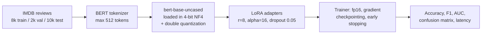

# QLoRA Fine-Tuning of BERT for Sentiment Classification

**Fine-tuning a 4-bit quantized `bert-base-uncased` with LoRA adapters on IMDB reviews: 91.6% test accuracy while training 0.44% of the weights, in 13 minutes on one GPU.**

[](https://colab.research.google.com/github/dojedaro/qlora-bert-sentiment-classification/blob/main/notebook/Finetuning_LLMs_LoRA.ipynb)
[](https://github.com/dojedaro/qlora-bert-sentiment-classification/actions/workflows/notebooks.yml)

## Results

Test set: 10,000 held-out reviews (48.8% positive), never seen during training or early stopping.

| Metric | Value |
|---|---|
| Accuracy | **0.9163** |
| Precision / Recall / F1 | 0.9163 / 0.9163 / 0.9163 |
| AUC-ROC | **0.9707** |
| Errors | 435 false negatives, 402 false positives (balanced) |
| Trainable parameters | 296,450 (0.44%) |
| Training time | 762 s for 3 epochs, 31.5 samples/s |
| Peak GPU memory (measured) | 0.97 GB |
| Inference | 60 ms per review, batch size 1 |

Validation accuracy (2,000 reviews) was 0.918, so the test score isn't the product of tuning on test data.

**What I didn't measure.** The notebook also prints a "16.5x less memory than full fine-tuning"
figure. That compares the measured 0.97 GB against an *estimated* 16 GB for full fine-tuning, and
another cell estimates full fine-tuning at about 1.0 GB, so the estimates disagree. Neither was
measured. The defensible claim is the one in the table: the whole run peaked under 1 GB of GPU memory.
(The notebook's "67M total parameters" is lower than BERT-base's ~110M because 4-bit layers report
packed weights.)

## How it works



- **QLoRA** keeps the base model frozen in 4-bit NF4 precision and trains small low-rank adapter
  matrices in 16-bit. Only the adapters and the classification head get gradients.
- **Memory savers:** fp16 training, gradient checkpointing and dynamic padding.
- **Tracking:** Weights & Biases logs every run.

## Run it

Needs a CUDA GPU (Colab's free T4 works) because `bitsandbytes` 4-bit kernels are GPU-only.

```bash
pip install -r requirements.txt
jupyter notebook notebook/Finetuning_LLMs_LoRA.ipynb
```

The dataset (`dipanjanS/imdb_sentiment_finetune_dataset20k`) downloads from the Hugging Face Hub.
W&B logging asks for an API key; set `WANDB_MODE=disabled` to skip it.

## Stack

Python, PyTorch, Hugging Face Transformers, PEFT, bitsandbytes, Accelerate, Datasets, scikit-learn, Weights & Biases.

## Limitations and next steps

- **Measure the comparison it claims:** run full fine-tuning on the same GPU and split, and report
  accuracy, peak memory and time side by side.
- BERT is small enough to fine-tune fully on most GPUs; QLoRA pays off on models of 7B+ parameters.
  The same recipe on a decoder LLM would make the efficiency argument for real.
- One run, one seed. Report a mean and spread over 3 seeds.

## License

MIT
